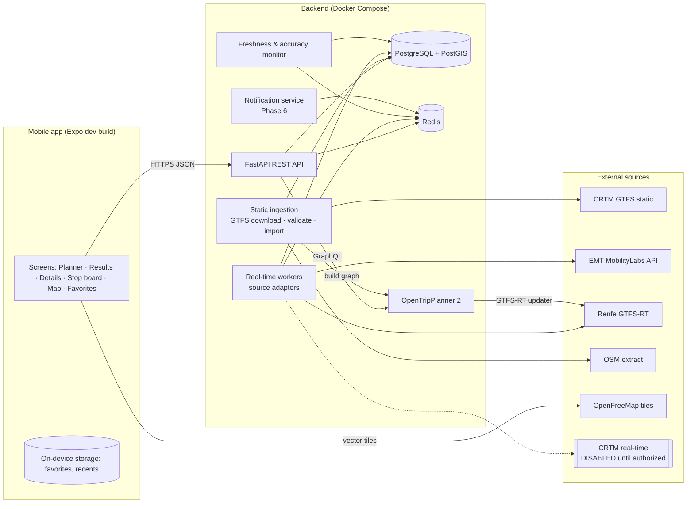
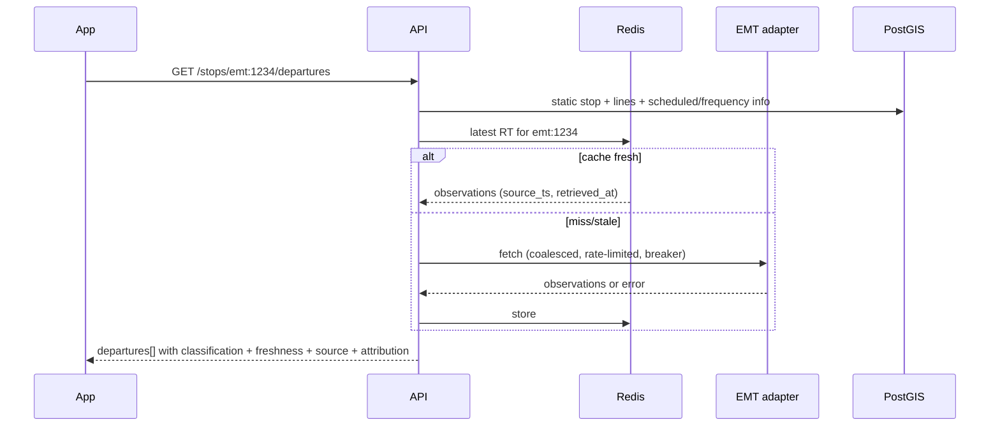

# Software Architecture

**Status:** Phase 0 proposal, 2026-11-09.

## 1. Stack evaluation

| Layer | Proposed | Verdict | Notes |
|---|---|---|---|
| Mobile | React Native + Expo + TypeScript | ✅ Keep | MapLibre RN **does not run in Expo Go**; use an Expo **development build** via its config plugin ([MapLibre Expo setup](https://maplibre.org/maplibre-react-native/docs/setup/expo)) |
| Backend | Python, FastAPI, Pydantic, REST | ✅ Keep | Good fit for adapters, GTFS processing (`gtfs-realtime-bindings`, protobuf) and async I/O |
| DB | PostgreSQL + PostGIS | ✅ Keep | Stops, geo queries, provenance and history |
| Cache | Redis | ✅ Justified | Shared real-time cache across users, rate-limit protection, and circuit-breaker state |
| Routing | OpenTripPlanner 2 | ✅ Keep, with caveats (§5) | v2.10.0 released 2026-09-09; requires **Java 25** |
| Maps | MapLibre + OpenFreeMap tiles (later self-hosted PMTiles) | ✅ | No API key; OSM attribution |
| Infra | Docker Compose, Git, GitHub | ✅ | No Kubernetes |
| Push | Expo Push Notifications (via APNs/FCM) | ✅ Phase 6 | Free service [I: confirm limits in Phase 6] |

No strong reason was found to change the proposed stack.

## 2. Component diagram



## 3. Responsibilities

| # | Component | Responsibility |
|---|---|---|
| 1 | Mobile app | UI, local favorites and recents, rendering data labels; holds **no secrets** |
| 2 | Backend API | Public REST API (`/stops/{id}/departures`, `/journeys`, `/alerts`, `/stops/near`, `/vehicles`); merges static, real-time and routing data; applies freshness labels |
| 3 | Transport data ingestion | Scheduled download of GTFS feeds and OSM; checksum and change detection |
| 4 | GTFS processing | Validation (MobilityData validator), normalization, import into PostGIS, feed-expiry checks, OTP graph build input |
| 5 | Real-time integration | One **adapter per source**, each emitting normalized `RealtimeObservation`, `VehiclePosition` and `ServiceAlert` objects |
| 6 | Normalization | Global ID scheme `{source}:{native_id}` (for example `crtm:par_8_16825`, `emt:1234`, `renfe:10000`) plus cross-source stop mapping table |
| 7 | Journey planning | OTP container; backend calls the OTP GraphQL API; post-processing adds reliability labels (RELIABILITY_STRATEGY.md §5) |
| 8 | Prediction and freshness monitor | Computes freshness states, stores prediction samples, computes accuracy metrics |
| 9 | Database | PostGIS (DATABASE_DESIGN.md) |
| 10 | Cache | Redis for latest real-time state per stop and trip, rate-limit buckets, circuit state |
| 11 | Notifications | Phase 6: journey monitors, Expo push |
| 12 | Monitoring and logging | Structured logs; Prometheus-format metrics endpoint; uptime checks |

## 4. Adapter interface

```python
class RealtimeAdapter(Protocol):
    source_id: str            # "renfe_gtfsrt", "emt_mobilitylabs", "crtm_widget"
    operator_ids: set[str]
    enabled: bool             # crtm_widget = False until authorization exists
    async def fetch(self) -> AdapterResult: ...   # observations + source_timestamp + retrieved_at + errors
```

- Two adapter styles:
  - **Feed adapters** poll a whole feed on a schedule (Renfe: every 20–30 s).
  - **On-demand adapters** fetch per stop when a user opens a stop board (EMT), with a short shared cache and request coalescing.
- The static pipeline and the real-time pipeline are **separate processes** that share only the database schema and the ID mapping.
- Adding an operator means one adapter, one config entry and tests. There are no changes to API or UI contracts.

## 5. OpenTripPlanner assessment

| Topic | Finding |
|---|---|
| GTFS compatibility | CRTM feeds are standard GTFS. OTP supports `frequencies.txt` (EMT and Metro are headway-based) [V spec; I: OTP expands frequency trips, to be tested in Phase 2] |
| Multiple feeds | OTP builds one graph from multiple GTFS feeds plus OSM [V] |
| OSM walking | Built in; transfers are computed from the street graph, so the missing `transfers.txt` is acceptable |
| Real-time | Updaters for GTFS-RT TripUpdates (polling, default `PT1M`), VehiclePositions, Alerts, MQTT streaming, and SIRI ([GTFS-RT config](https://docs.opentripplanner.org/en/latest/GTFS-RT-Config/)) [V] |
| Delay propagation | `backwardsDelayPropagationType` and forward propagation exist; Renfe TripUpdates mostly carry one stop update, so propagation matters [V] |
| Trip matching | Requires RT `trip_id` to match static GTFS; `fuzzyTripMatching` optional [V] |
| Transfers | `transferSlack` default `PT2M`; `boardSlack`/`alightSlack` per mode; `transferPenalty` for fewest-transfer bias ([RouteRequest](https://docs.opentripplanner.org/en/latest/RouteRequest/)) [V] |
| Optimization | Pareto search over time, transfers and generalized cost; no single "reliable connections" mode, so MadridGo implements its own reliability layer |
| Resources | "From less than one GB to more than 100 GB"; Finland ≈ 10 GB, Germany 95 GB; single-thread performance matters ([System Requirements](https://docs.opentripplanner.org/en/latest/System-Requirements/)) [V]. **Madrid estimate: 4–8 GB heap** [I]; must be measured in Phase 2 |
| Java | OTP2 requires Java 25 [V] |

**What OTP does not do (MadridGo must build it):**
- Consume the EMT REST API: it is not GTFS-RT, and EMT GTFS is frequency-based, so RT matching to trips is not meaningful. EMT live data is overlaid at the **stop-board level**, not inside routing, in the MVP.
- Freshness labels, provenance, and transfer reliability labels.
- Journey monitoring and notifications.
- Accuracy measurement.

**Verdict:** suitable as the routing core. It is the most mature open-source multimodal planner with native GTFS-RT. Main risks are input-data quality (expired Metro) and RAM sizing.

## 6. Key data flows

### 6.1 Stop departure board


### 6.2 Journey planning
App → API `/journeys` → OTP GraphQL (with Renfe RT applied inside OTP) → API post-processing (reliability labels, EMT stop-level live overlay where a leg boards an EMT stop, freshness) → App.

## 7. Architectural decisions (ADR summary)

| ADR | Decision | Reason |
|---|---|---|
| 001 | Backend proxies **all** third-party data | Keeps keys secret; shared cache reduces upstream load; enforces attribution and licence compliance centrally |
| 002 | Per-source adapters with an `enabled` flag | Allows the CRTM adapter to exist in code and tests but stay off in all environments until authorized |
| 003 | Real-time is separate from static ingestion | Different cadences and failure modes; static rebuilds must not interrupt live data |
| 004 | Favorites on-device for MVP | GDPR minimization; no account needed |
| 005 | OTP for routing, MadridGo layer for reliability | OTP lacks provenance and reliability labelling |
| 006 | Expo development builds, not Expo Go | MapLibre native module |
| 007 | Monorepo `apps/mobile`, `services/api`, `services/workers`, `infra/` | One repo for a small team; shared OpenAPI-generated TS types |
| 008 | **Website from the same Expo codebase** (react-native-web, `expo export --platform web` gives static files) | One codebase for iOS, Android and web. The site is static files served by the same Caddy that fronts the API, so it costs nothing extra |

### 7.1 Web-specific notes (ADR 008)
- **CORS:** the API allows only configured origins (`MADRIDGO_CORS_ORIGINS`). Production adds the website's domain. Verified locally: `http://localhost:8081` is allowed and unknown origins are not.
- **Maps:** `@maplibre/maplibre-react-native` is a native module. Web support must be checked in Phase 5 [U]. The fallback is a platform-specific `Map.web.tsx` using `maplibre-gl` (MapLibre GL JS) with the same OpenFreeMap style.
- **Secrets:** a website is fully public, so the "no keys in the client" rule (ADR 001) matters even more. EMT credentials stay in the backend.
- **Same origin in production:** serve the website at `https://<domain>/` and the API at `https://<domain>/api` behind one Caddy, which avoids cross-origin requests entirely.
- **SEO (later):** stop and line pages could be pre-rendered (Expo Router static rendering) so that searches such as "parada 8_16825" find MadridGo. This would come after the MVP.
